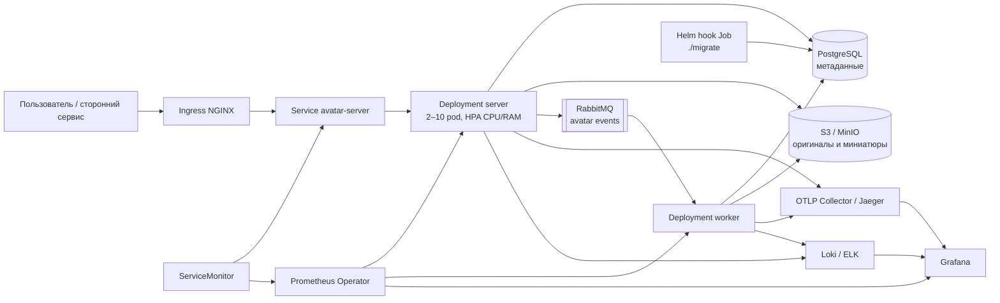

# Архитектура GophProfile

## Потоки данных

1. Server проверяет `X-User-ID`, размер и содержимое изображения, сохраняет оригинал в S3 и метаданные в PostgreSQL, затем публикует событие в RabbitMQ.
2. Worker получает событие, создаёт миниатюры 100×100 и 300×300, сохраняет их в S3 и обновляет статус аватара. Обработка идемпотентна, ошибки повторяются с экспоненциальной задержкой.
3. При чтении server отдаёт оригинал или готовую миниатюру с `ETag` и `Cache-Control`. При удалении запись сначала помечается удалённой, а событие физического удаления обрабатывает worker.
4. Распределённые trace context передаются через HTTP и RabbitMQ. JSON-логи содержат `trace_id`, а Prometheus собирает технические и бизнес-метрики.

## Kubernetes и Helm

- Server и worker — независимые Deployment с requests/limits, restricted SecurityContext и отдельными ServiceAccount без автоматически монтируемого токена.
- `/live` проверяет только работоспособность HTTP-процесса. `/ready` и `/health` проверяют PostgreSQL, S3 и RabbitMQ.
- HPA масштабирует server по CPU и памяти. RollingUpdate, PodDisruptionBudget, `preStop` и graceful shutdown сохраняют доступность при обновлениях.
- NetworkPolicy запрещает трафик по умолчанию и разрешает только Ingress, Prometheus, DNS и необходимые исходящие порты.
- ServiceMonitor автоматически добавляет endpoint server и worker в Prometheus Operator.
- Helm `post-install`/`post-upgrade` Job запускает `./migrate`. Миграции идемпотентны и защищены PostgreSQL advisory lock. Server в Chart запускается с `RUN_MIGRATIONS=false`.
- PostgreSQL, S3/MinIO, RabbitMQ и observability-стек подключаются как внешние сервисы через values и Secret; Chart не управляет их данными и жизненным циклом.
